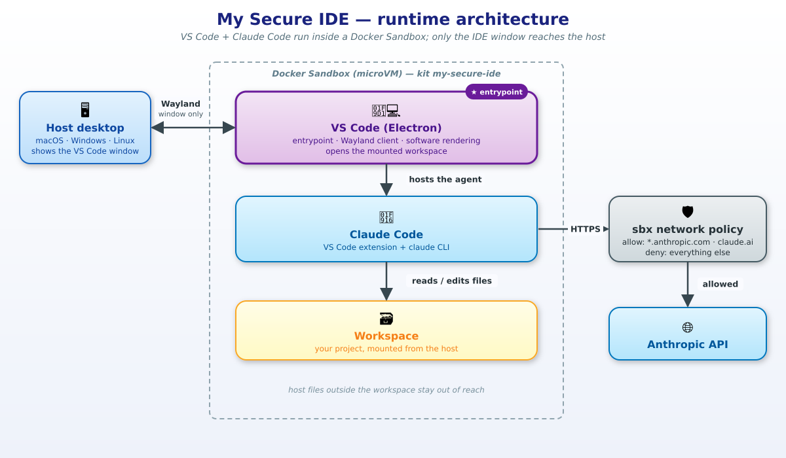

# How to completely secure VSCode and Claude Code by running them directly in SBX




## Start VSCode

```bash
sbx run --display --name sbx-vscode-claude ./kit .
```

## Start VSCode + Toolchain Kits 

```bash
sbx run --display --name sbx-vscode-claude ./kit . \
--kit docker.io/k33g/go-toolchain-kit:0.0.2 \
--kit docker.io/k33g/rust-toolchain-kit:0.0.2
```