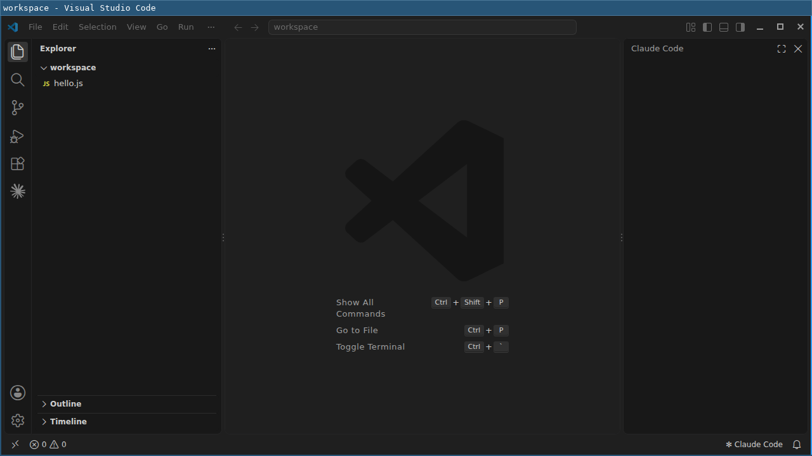

# My Secure IDE — VS Code + Claude Code in a Docker Sandbox

*🇫🇷 Version française : [README.fr.md](README.fr.md)*

A **Kits v3** demo for Docker Sandboxes (`sbx`): VS Code and Claude Code run **inside** a sandbox (microVM), and only the **VS Code window** shows up on your desktop.

- The agent (Claude Code) and the IDE can only see the **mounted project**, not the rest of your machine.
- Network access is limited to **what the kit allows** (the Anthropic API and sign-in).
- Everything (VS Code, the Claude Code extension, the `claude` CLI, settings) is **baked into the image**: one command and everyone gets the same environment.



> Architecture and diagrams: [docs/architecture.md](docs/architecture.md)

---

## Prerequisites

| Item | Detail |
|---|---|
| Docker Sandboxes | `sbx` **v0.48+** (Kits v3 support) |
| `--display` option | **Experimental**. If `sbx run --help` doesn't show it, enable the feature flag: `export DOCKER_SANDBOXES_FEATURE_SANDBOX_DISPLAY=1` |
| Claude account | Claude subscription or Anthropic API key, for Claude Code |

## Folder layout

```
sbx-vscode-claude/
├── kit/                         # the kit v3 (what sbx builds)
│   ├── kit.yaml                 # descriptor: args, capabilities, network policy, agent context
│   ├── kit.dockerfile           # the image: VS Code + Claude Code on top of the shell template
│   ├── bin/
│   │   ├── sbx-vscode-claude-session   # entrypoint: waits for the Wayland display, then starts VS Code
│   │   ├── sandbox-code            # launches VS Code with the "no GPU / Wayland" flags
│   │   └── sandbox-desktop         # nested labwc desktop, with the keyboard layout from the kit args
│   ├── config/                  # VS Code settings (no telemetry, no updates, no Copilot)
│   ├── applications/            # .desktop entry
│   └── sbx-vscode-claude-context.md # guidance given to the agent (agent-context)
├── tests/
│   ├── test-display.sh          # smoke test without sbx (headless Wayland compositor)
│   ├── test-desktop.sh          # same idea, for sandbox-desktop
│   └── wayland-headless.Dockerfile
└── docs/
    ├── architecture.md
    ├── wayland-keyboard.md      # Wayland, --display and the keyboard layout
    ├── diagrams/                # .drawio (editable) + .svg + .png, generated by generate.py
    └── images/
```

## Start the IDE

From the `sbx-vscode-claude` folder:

```bash
# Start VS Code on a project (here ~/projects/my-app)
sbx run --display --name sbx-vscode-claude ./kit ~/projects/my-app
```

- `--display` is **required**. It gives the sandbox a Wayland socket (`/run/display/wayland-0`) whose windows show up on your desktop. It must be passed **when the sandbox is created**.
- `./kit` is the kit reference. Relative paths must be written explicitly (`./…`).
- With no workspace path, the **current directory** is mounted.
- On the first run, `sbx` builds the kit image. Later runs reuse it.

The VS Code window opens with the project and **Claude Code** (icon in the sidebar and in the status bar). **Closing the window ends the session.**

### Pin versions (kit args)

```bash
sbx run --display --name sbx-vscode-claude \
  --kit-arg vscodeVersion=1.141.1 \
  --kit-arg claudeCodeVersion=2.1.299 \
  ./kit ~/projects/my-app
```

| Arg | Default | Purpose |
|---|---|---|
| `vscodeVersion` | `latest` | VS Code version (Microsoft apt repository) |
| `claudeCodeVersion` | `latest` | `@anthropic-ai/claude-code` CLI version (npm) |
| `waylandSocket` | `/run/display/wayland-0` | Wayland socket VS Code draws on |

### Use Claude Code

- **In VS Code**: click the Claude Code icon (sidebar) and sign in on first launch.
- **In the terminal**: open VS Code's integrated terminal (`` Ctrl+` ``) and run `claude`.
- **From the host**, without going through the window:
  ```bash
  sbx exec sbx-vscode-claude claude --version
  ```

### AZERTY and other keyboard layouts (labwc desktop)

Windows drawn straight on the sandbox display don't follow the host's keyboard layout: you end up in QWERTY. The kit ships `sandbox-desktop`, which opens a **labwc** desktop nested in the display. Apps started inside it use the layout set by the kit args.

```bash
sbx exec -it sbx-vscode-claude -- sandbox-desktop           # a foot terminal
sbx exec -it sbx-vscode-claude -- sandbox-desktop <command> # any other app
```

Set the layout at creation:

```bash
sbx run --display --name sbx-vscode-claude \
  --kit-arg keyboardLayout=ch --kit-arg keyboardVariant=fr \
  ./kit ~/projects/my-app
```

| Arg | Default | Purpose |
|---|---|---|
| `keyboardLayout` | `fr` | XKB layout (`fr`, `ch`, `de`, `us`…) |
| `keyboardVariant` | `mac` | XKB variant: `mac` for an Apple keyboard, empty (`keyboardVariant=`) for a PC keyboard |

Closing the labwc window (or Ctrl+C in the host terminal) ends the desktop. The entrypoint's VS Code still draws straight on the display, so it stays in QWERTY (see *Known limitations*).

How it works (Wayland, `--display`, nested compositor): [docs/wayland-keyboard.md](docs/wayland-keyboard.md).

### Re-attach, stop, delete

```bash
sbx run --name sbx-vscode-claude          # re-attach to the existing sandbox (spec already known)
sbx ls                                 # list sandboxes
sbx rm sbx-vscode-claude                   # delete the sandbox
```

## Network policy

The kit only allows the hosts that Claude Code needs (`kit.yaml` → `network-policy@1`):

```yaml
allow:
  - api.anthropic.com
  - anthropic.com / *.anthropic.com
  - claude.ai / *.claude.ai
  - claude.com / *.claude.com
```

The **VS Code marketplace is blocked** at runtime, because extensions are installed when the image is built. To let developers install other extensions, uncomment the marketplace lines in `kit.yaml`. The organization's policies (AI Gov) still apply on top of the kit's.

## Share the kit with the team

```bash
sbx kit validate ./kit                               # validate the kit
sbx kit push ./kit registry.example.com/team/sbx-vscode-claude:0.1.0
# Then, for everyone:
sbx run --display registry.example.com/team/sbx-vscode-claude:0.1.0 ~/projects/my-app
```

## Test without sbx (CI or a machine without a display)

`tests/test-display.sh` builds the image, starts a **headless Wayland compositor** (sway) in place of the one `sbx` provides, starts the IDE on it and takes a screenshot:

```bash
./tests/test-display.sh
# ==> Windows on the compositor:  "app_id": "com.microsoft.VSCode"
# ==> Screenshot: tests/out/screenshot.png
```

`tests/test-desktop.sh` does the same for `sandbox-desktop`. It checks that labwc opens a single window on the compositor, that foot draws inside labwc rather than straight on the display, and that the layout comes from the kit args:

```bash
./tests/test-desktop.sh
# ==> OK. Screenshot: tests/out/desktop-screenshot.png
```

## Demo script (≈ 5 min)

1. **The problem**: "Coding agents get access to the whole machine: `~/.ssh`, `~/.aws`, the network…"
2. **One command**: `sbx run --display ./kit ~/projects/my-app`. The VS Code window opens like a local app.
3. **The agent at work**: ask Claude Code to change a file in the project. The change shows up on the host, in the project.
4. **The confinement**: in the integrated terminal, `ls ~/.ssh` and `cat /etc/hostname` show you're in the sandbox, not on the host. `curl https://example.com` is blocked by the policy.
5. **Reproducibility**: `sbx kit push …` publishes the kit; any team member gets **exactly** the same IDE.

## Known limitations

- `--display` is **experimental** (feature flag `feature.sandbox-display`).
- **No GPU**: software rendering. Smooth enough for an IDE, but not for heavy graphics.
- **Keyboard layout**: windows drawn straight on the sandbox display (including the entrypoint's VS Code) stay in QWERTY. Only apps started through `sandbox-desktop` follow `keyboardLayout`. Running `sandbox-code` inside `sandbox-desktop` isn't enough while the entrypoint's VS Code is running: VS Code allows a single instance, so the window would open in the one that already exists.
- **No keyring / D-Bus**: VS Code stores its secrets with `--password-store=basic`. Sign-ins may need to be redone after a sandbox is recreated.
- The image is large (≈ 4.9 GB unpacked, of which 2.1 GB is the shell template; VS Code and Claude Code add the rest). The first build takes a few minutes.
- **Not yet validated end to end with `sbx`**: the image and the Wayland display were tested with a headless compositor (see `tests/`). Real `sbx run --display`, the network policy and Claude Code sign-in from inside the sandbox still need to be checked on a machine with `sbx`.
