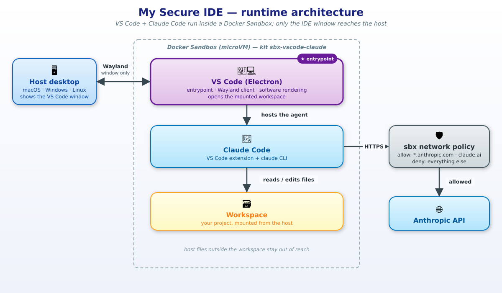
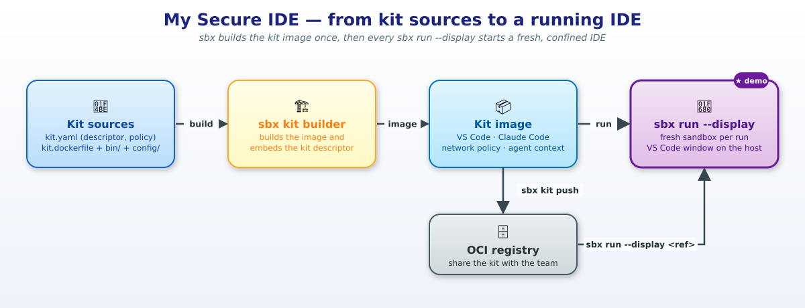

# My Secure IDE — Architecture

*🇬🇧 English version: [architecture.md](architecture.md)*

## Vue d'ensemble



My Secure IDE est un **kit de type workload** (Kits v3) pour Docker Sandboxes. Contrairement à un kit classique, où l'agent tourne dans un terminal, ici **VS Code est l'entrypoint de la sandbox**. Il dessine sa fenêtre sur un affichage Wayland fourni par `sbx`, et cette fenêtre apparaît sur le bureau de l'hôte.

| Composant | Où il tourne | Rôle |
|---|---|---|
| **Bureau de l'hôte** | Hôte | Affiche la fenêtre VS Code (compositeur natif). Ne reçoit **que les pixels et les événements clavier/souris** : ni fichiers, ni processus. |
| **VS Code (Electron)** | Sandbox | Entrypoint. Client Wayland en rendu logiciel (pas de GPU). Ouvre le workspace monté. |
| **Claude Code** | Sandbox | Agent de code : extension VS Code `anthropic.claude-code` + CLI `claude`. |
| **Workspace** | Monté dans la sandbox | Le seul dossier de l'hôte que l'IDE et l'agent peuvent voir et modifier. |
| **Network policy sbx** | Proxy sbx | Filtre tout le trafic sortant. Seule l'allowlist du kit (Anthropic) passe, en plus des policies de l'organisation. |

## Cycle de vie



1. **Sources du kit** : `kit.yaml` (descripteur) + `kit.dockerfile` (image) + les fichiers `bin/`, `config/` et `applications/`.
2. **Build** : `sbx` construit l'image à partir de `docker/sandbox-templates:shell` et intègre le descripteur du kit (args, capacités, policy) dans les annotations de l'image.
3. **Run** : `sbx run --display ./kit <workspace>` crée la microVM, monte le workspace, applique la network policy et fournit la socket Wayland.
4. **Partage** (optionnel) : `sbx kit push` publie le kit dans un registre OCI. Les autres lancent `sbx run --display <ref>`.

## Séquence de démarrage

```
sbx run --display ./kit ~/projects/my-app
  │
  ├─ sbx : crée la microVM, monte ~/projects/my-app, applique network-policy@1,
  │        fournit /run/display/wayland-0 (socket Wayland reliée au compositeur de l'hôte)
  │
  └─ entrypoint : tini -- /opt/my-secure-ide/bin/my-secure-ide-session
        ├─ attend la socket Wayland (120 s max, sinon erreur claire : « --display ? »)
        └─ exec sandbox-code --wait "$PWD"
              └─ /usr/bin/code --ozone-platform=wayland --disable-gpu --no-sandbox
                                --password-store=basic …
                    └─ fenêtre VS Code → compositeur de l'hôte
```

- **`tini`** récupère les processus enfants d'Electron (renderer, extension host…).
- **`--wait`** garde le processus VS Code au premier plan : fermer la fenêtre termine la session.
- **`sbx exec`** donne toujours un shell, par exemple pour lancer `claude` sans passer par la fenêtre.

## Descripteur du kit v3 (`kit.yaml`)

| Section | Contenu |
|---|---|
| `kind: workload` | Kit complet : il fournit l'image **et** l'entrypoint (contrairement à un `mixin`, qui étend un kit existant). |
| `args` | `vscodeVersion`, `claudeCodeVersion` (build args), `waylandSocket` (env runtime `SANDBOX_WAYLAND_SOCKET`). |
| `com.docker.sandbox/sbx@1` | Intégration standard à la sandbox (template shell, `sbx exec`…). |
| `com.docker.sandbox/network-policy@1` | Allowlist runtime : `api.anthropic.com`, `*.anthropic.com`, `claude.ai`, `*.claude.ai`, `claude.com`, `*.claude.com`. |
| `com.docker.sandbox/agent-context@1` | `my-secure-ide-context.md` : explique à l'agent comment fonctionne l'environnement (affichage Wayland, pas de GPU, marketplace bloqué…). |

## Choix de conception

| Choix | Pourquoi |
|---|---|
| **VS Code comme entrypoint** (et pas un bureau complet) | L'hôte voit **une fenêtre d'application**, pas un bureau distant. C'est plus léger et plus naturel pour le développeur. |
| **Wayland + rendu logiciel** | `sbx --display` fournit une socket Wayland. La sandbox n'a pas de GPU, donc `--disable-gpu` évite une fenêtre qui reste blanche. |
| **Extensions et CLI installées au build** | Pas de dépendance au marketplace à l'exécution, donc une allowlist plus courte. Environnement identique et versionné pour tous (`--kit-arg`). |
| **Réglages VS Code par défaut** | Pas de télémétrie, pas de mises à jour automatiques, onboarding Copilot désactivé (`chat.disableAIFeatures`). La démo va directement à Claude Code. |
| **`--password-store=basic`** | Pas de keyring ni de D-Bus dans la sandbox. Sans cette option, VS Code échoue à stocker ses secrets. |
| **Claude Code installé hors de `$HOME` (préfixe npm)** | Un montage ne peut pas le masquer. Les binaires musl inutiles sont supprimés, ce qui fait gagner ≈ 250 Mo. |

## Modèle de sécurité

- **Fichiers** : seul le workspace est monté. Le reste de l'hôte (`~/.ssh`, `~/.aws`, les autres projets) est hors de portée de l'IDE **et** de l'agent.
- **Réseau** : tout le trafic sortant passe par le proxy sbx. Le kit n'autorise que ce dont Claude Code a besoin, et les policies de l'organisation (AI Gov) s'appliquent en plus.
- **Affichage** : le compositeur de l'hôte reçoit le rendu de la fenêtre et renvoie le clavier et la souris. C'est le seul canal entre l'IDE et le bureau de l'hôte.
- **Reproductibilité / confiance** : le kit peut être signé (`sbx kit sign`) et vérifié (`sbx kit verify`) avant d'être distribué.

## Tester sans sbx

`tests/test-display.sh` reproduit le contrat de `--display` sans `sbx`. Un compositeur **sway headless** (rendu pixman) partage sa socket Wayland avec le conteneur du kit via un volume Docker, dans le rôle de `/run/display/wayland-0`. Le script vérifie qu'une fenêtre `com.microsoft.VSCode` apparaît et fait une capture d'écran avec `grim`.

Ce que ce test **ne couvre pas** : la microVM, la network policy, le montage du workspace par `sbx` et le rendu sur le compositeur de l'hôte.

## Schémas

Les fichiers `.drawio` (éditables dans app.diagrams.net), `.svg` et `.png` de `diagrams/` sont produits par `diagrams/generate.py`. Une seule description par schéma pilote les deux formats. Pour modifier un schéma :

```bash
cd docs/diagrams
python3 generate.py                          # régénère .drawio + .svg
for f in runtime-architecture kit-build-and-run; do rsvg-convert -o $f.png $f.svg; done
```
